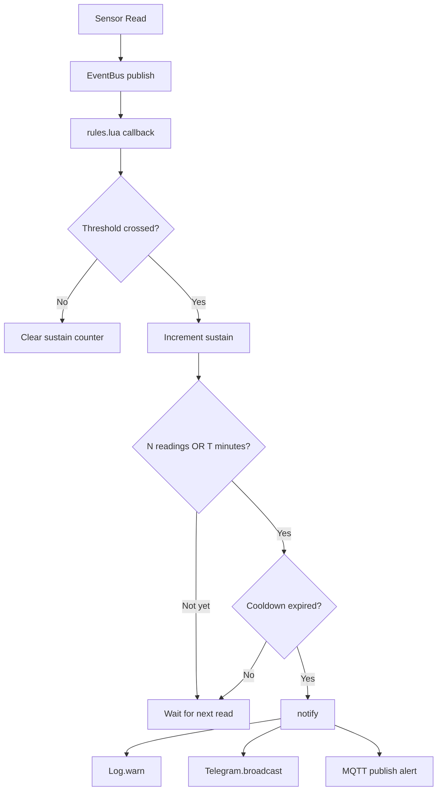

# Alerts & Webhook



## Lua Alert Engine

Alert logic lives in `/scripts/rules.lua` on LittleFS - hot-reloadable without recompiling. The firmware provides the bindings; the script defines the rules.

<!-- claim: repo=thesada-fw ref=dev file=lib/thesada-mod-telegram/src/TelegramModule.cpp match="luaL_optstring\(L, 2, \"telegram\"\)" -->
**Available Lua bindings for alerts:**

| Function | Description |
|---|---|
| `EventBus.subscribe(event, fn)` | Subscribe to sensor events (`temperature`, `current`, `battery`) |
| `Telegram.send(chat_id, msg)` | Send to a specific Telegram chat |
| `Telegram.broadcast(msg[, code])` | Publish `<prefix>/alert` as `{"severity":"warn","code":code,"message":...}` at once, and queue the send to all configured `chat_ids` and the webhook. `code` defaults to `telegram`. Returns `true` once the app alert is out, `false` only for an empty message. Chat and webhook delivery is best effort, each skip is logged. For another severity, publish your own alert JSON with `MQTT.publish` and use `Telegram.send` per chat instead, and note that the webhook then gets nothing |
| `MQTT.publish(topic, payload)` | Publish alert to MQTT |
| `Config.get(key)` | Read config values (supports dot notation and array indices) |
| `Node.uptime()` | Current uptime in ms (for cooldown/sustain timing) |
| `Node.setTimeout(ms, fn)` | Delayed execution (e.g. boot alerts after WiFi ready) |
| `Log.warn(msg)` | Log alert to serial/WebSocket terminal |

**Telegram config (`config.json`):**

```json
"telegram": {
  "bot_token": "your-bot-token",
  "chat_ids": ["12345678910", "-10987654321"]
}
```

Both array and object format supported for `chat_ids`:
```json
"chat_ids": {"user1": "12345678910", "user2": "-10987654321"}
```

Object format enables per-recipient routing in Lua:
```lua
local user1 = Config.get("telegram.chat_ids.user1")
Telegram.send(user1, "critical alert")
```

## Example rules.lua

```lua
local unit   = Config.get("temperature.unit") or "C"

local sustain = {}
local cooldown = {}
local COOLDOWN_MS = 900000   -- 15 minutes
local TEMP_SUSTAIN = 5       -- 5 readings or 5 minutes

local function can_alert(key)
  local now = Node.uptime()
  if cooldown[key] and (now - cooldown[key]) < COOLDOWN_MS then
    return false
  end
  cooldown[key] = now
  return true
end

-- JSON string literal: escape quote, backslash and control characters.
local function json_str(s)
  local body = tostring(s):gsub('[%c"\\]', function(c)
    if c == '"' or c == "\\" then return "\\" .. c end
    return ("\\u%04x"):format(c:byte())
  end)
  return '"' .. body .. '"'
end

-- Alert JSON under 256 bytes: a longer payload is dropped while it waits in
-- the offline queue. Cuts the message on a UTF-8 character boundary.
local function alert_json(code, msg)
  local head = '{"severity":"warn","code":' .. json_str(code) .. ',"message":'
  local m = tostring(msg)
  local out = head .. json_str(m) .. '}'
  while #out > 255 and #m > 0 do
    local n = #m - 1
    while n > 0 and m:byte(n + 1) >= 0x80 and m:byte(n + 1) < 0xC0 do n = n - 1 end
    m = m:sub(1, n)
    out = head .. json_str(m) .. '}'
  end
  return out
end

-- One alert per firing. Telegram.broadcast publishes it and queues the chats,
-- without the Telegram module the script publishes it itself.
local function notify(code, msg)
  Log.warn(msg)
  if Telegram then
    Telegram.broadcast(msg, code)
  else
    -- Read at fire time, so a config.reload that moves the prefix moves alerts too.
    local prefix = Config.get("mqtt.topic_prefix") or "thesada/node"
    MQTT.publish(prefix .. "/alert", alert_json(code, msg))
  end
end

-- Temperature: sustained low temp alert
EventBus.subscribe("temperature", function(data)
  for _, s in ipairs(data.sensors) do
    local key = "low_temp:" .. s.name
    if s.name == "House Supply" and s.temp_c and s.temp_c <= 55 then
      sustain[key] = (sustain[key] or 0) + 1
      if sustain[key] >= TEMP_SUSTAIN and can_alert(key) then
        notify("low_temp", s.name .. ": " .. s.temp .. unit .. " - Low temp")
        sustain[key] = 0
      end
    else
      sustain[key] = 0
    end
  end
end)

-- Battery: immediate alert
EventBus.subscribe("battery", function(data)
  if data.present and data.percent <= 20 and not data.charging then
    if can_alert("battery_low") then
      notify("battery_low", "Battery low: " .. data.percent .. "%")
    end
  end
end)
```

The envelope matters: the platform keeps only JSON alerts with `severity` in `info`, `warn` or `crit` and reads `code` and `message` from them. `Telegram.broadcast` builds that JSON itself, and the `Telegram` global exists only when the module is built and enabled, hence the fallback in `notify`. A script that publishes its own alert with `MQTT.publish` builds the string by hand, since there is no `JSON.encode` binding, and must escape quote, backslash and control characters so a sensor name cannot break it. A plain-string publish reaches the log, but the platform drops it at ingest.

<!-- claim: repo=thesada-fw ref=dev file=lib/thesada-core/src/MQTTClient.h match="char payload\[256\];" -->
<!-- claim: repo=thesada-fw ref=dev file=lib/thesada-core/src/MQTTClient.cpp match="mqtt.queue_rejected reason=oversize" -->
<!-- claim: repo=thesada-fw ref=dev file=lib/thesada-mod-telegram/src/TelegramModule.cpp match="alertMessageFit\(\"warn\", code, body, 256 - strlen\(crumb\)\)" -->
<!-- claim: repo=thesada-fw ref=dev file=lib/thesada-mod-scriptengine/src/ScriptEngine.cpp match="if \(current.isNull\(\)\) \{\n    lua_pushnil\(L\);" -->
<!-- claim: repo=thesada-fw ref=dev file=lib/thesada-core/src/MQTTClient.cpp match="cfg\[\"mqtt\"\]\[\"topic_prefix\"\] \| \"thesada/node\"" -->
Keep the whole JSON under 256 bytes. While the device is offline a publish waits in a queue of 256-byte slots, and a longer payload is dropped there with `mqtt.queue_rejected reason=oversize`. `alert_json` cuts the message until the JSON fits and never splits a UTF-8 character, so a sensor name with an umlaut still arrives as valid JSON. `Telegram.broadcast` fits its alert into the same slot itself. `Config.get` returns `nil` for a key that is not in `config.json`, so the script falls back to `thesada/node`, the prefix the firmware uses when `mqtt.topic_prefix` is unset.

<!-- claim: repo=thesada-fw ref=dev file=lib/thesada-core/src/Shell.cpp match="out\(\"Network config changed - reinitializing MQTT subscriptions\"\);\n    MQTTClient::reinitSubscriptions\(\);" -->
<!-- claim: repo=thesada-fw ref=dev file=examples/scripts/rules.lua.example match="MQTT.publish\(Config.get\(\"mqtt.topic_prefix\"\) .. \"/alert\"," -->
`notify` reads the prefix each time an alert fires. `config.reload` moves the firmware's own topics to a new `mqtt.topic_prefix` but does not rerun the scripts, so a prefix cached when the script loaded would keep sending alerts to the old topic until `lua.reload` or a restart.

**EventBus data format (temperature):**

```json
{
  "sensors": [
    { "name": "House Supply", "temp_c": 54.4, "temp": 129.9, "address": "28..." }
  ]
}
```

- `temp_c` - always Celsius (use for thresholds)
- `temp` - display unit (C or F depending on `temperature.unit` config)

A probe without a usable reading is listed as `{ "name": "House Supply", "address": "28...", "stale": true }`, with no `temp_c` or `temp`. Rules guard the field (`s.temp_c and ...`) as above, or test `s.stale`; an unguarded compare throws and ends the loop over the remaining probes. The sustain counter resets when the field is missing, so a dead probe cannot raise a low-temp alert - alert on the stale state itself if that matters.

**Sustain pattern:** alert only fires after N consecutive readings cross the threshold. Prevents false alerts from single sensor glitches or brief temperature dips when loading fuel.

**Cooldown pattern:** after an alert fires, the same key won't fire again for `COOLDOWN_MS` milliseconds. Prevents alert spam when a condition persists.

---

## Webhook

Optional HTTP POST fired from Lua or TelegramModule on every alert:

```json
"webhook": {
  "url": "http://homeassistant.local:8123/api/webhook/module-alert",
  "message_template": "{{value}}"
}
```

`{{value}}` is replaced with the full alert message. Supports `http://` and `https://`. Leave `url` empty to disable.

A query on the host root is kept: `https://host?key=abc` posts to `/?key=abc`. TCP connect and each write are capped at 5 s for the webhook and Telegram clients.

HTTPS webhook endpoints are unverified by default (the URL is arbitrary, so there is no CA to pin ahead of time). To verify TLS, upload the endpoint's root certificate - self-signed works - as `/webhook-ca.crt` via the file API, then restart:

```bash
curl -u admin:<password> -X POST \
  'http://[ip]/api/file?path=/webhook-ca.crt&source=littlefs' \
  -H 'Content-Type: application/octet-stream' \
  --data-binary @webhook-ca.crt
```

Same override pattern as `/telegram-ca.crt` and `/ca.crt`; remove the file (and restart) to fall back to unverified. The boot log states which mode is active.

---

## Boot alert (main.lua)

Send a Telegram message when the node starts (delayed 10s for WiFi/firewall):

```lua
Node.setTimeout(10000, function()
  local name = Config.get("device.name") or "unknown"
  local ip = Node.ip() or "no IP"
  Telegram.broadcast(name .. " booted - " .. ip)
end)
```

---

## Home Assistant automation for MQTT alerts

```yaml
automation:
  - alias: "Thesada Node Alert - Telegram"
    triggers:
      - trigger: mqtt
        topic: thesada/node/alert
    actions:
      - action: notify.send_message
        data:
          entity_id: notify.telegram_notify
          message: "{{ trigger.payload }}"
```
