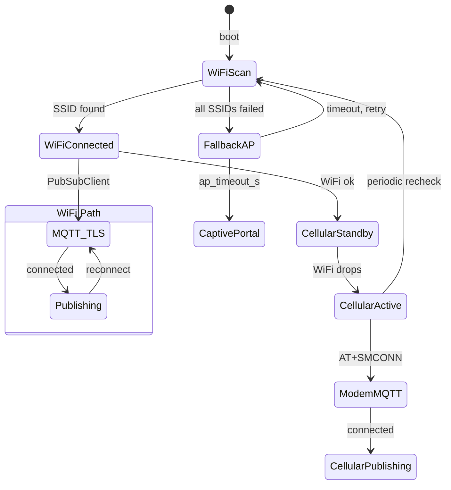
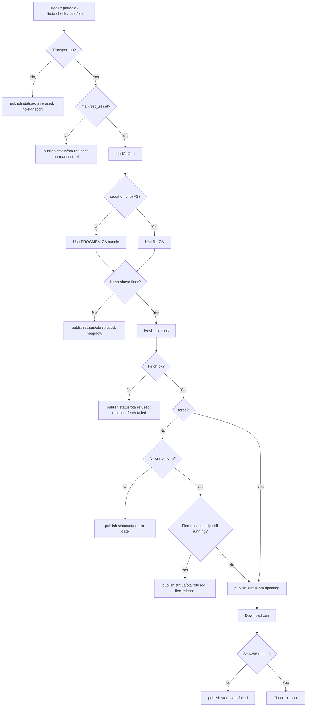

# Connectivity & OTA

## Connectivity State Machine



WiFi is always tried first. Each SSID is retried up to `wifi.retries` times (default 2) before moving on. If no WiFi network is in range, the fallback AP starts a captive portal for local configuration - provided its passphrase is usable, see below. Cellular activates in parallel when WiFi fails.

## OTA Update (OTAUpdate)

HTTP(S) pull-based OTA. The device fetches a JSON manifest, compares semver, and streams + verifies the firmware binary.



**Manifest format** (`build/firmware.json`, generated by `scripts/generate_manifest.py`):
```json
{
  "version": "1.x",
  "url": "https://example.com/firmware.bin",
  "sha256": "abc123..."
}
```

**Triggers:**
1. Periodic interval check (default 6 h, configurable via `ota.check_interval_s`)
2. First check runs at boot when a network is already up
3. Shell command `ota.check [--force] [url]` - over serial, WebSocket, HTTP POST `/api/cmd`, or MQTT CLI topic `<prefix>/cli/ota.check`
4. MQTT message to `ota.cmd_topic` (any payload) - defaults to `<topic_prefix>/cmd/ota`

Trigger over MQTT CLI (recommended - no external scripts, response on `<prefix>/cli_response`):
```bash
# use config manifest_url, version check
mosquitto_pub ... -t '<prefix>/cli/ota.check' -m ''

# use config manifest_url, skip version check (re-flash same or older)
mosquitto_pub ... -t '<prefix>/cli/ota.check' -m '--force'

# use override URL, version check
mosquitto_pub ... -t '<prefix>/cli/ota.check' -m 'https://example.com/firmware.json'

# use override URL, force re-flash
mosquitto_pub ... -t '<prefix>/cli/ota.check' -m '--force https://example.com/firmware.json'
```

<!-- claim: repo=thesada-fw ref=fix/ota-abandoned-identity file=lib/thesada-core/src/OTAUpdate.cpp match="Log::warn\(TAG, \"ota.force_reflash version=fled\"\);" -->
Force mode bypasses `isNewer()` and the [fled-release skip](#the-fled-release-skip), so dev iteration does not need a `FIRMWARE_VERSION` bump every test cycle. Intended for development and for recovering a stuck device without version juggling.

**Watchdog-safe download loop**: the per-chunk download path feeds the task watchdog after each `Update.write()` and uses short socket + handshake timeouts (10 s) on the local `WiFiClientSecure`. This prevents a slow `readBytes()` on a flaky upstream from blocking the client past the ~5 s task watchdog window and panic-rebooting mid-flash. Required for OTA reliability on weak wireless links.

**TLS:** loads `/ca.crt` from LittleFS. If the file is missing or empty, the OTA client falls back to a PROGMEM bundle of common public TLS roots baked into the firmware. The OTA path stays cert-validated even when the LittleFS data partition has been wiped.

**config.json keys:**
```json
"ota": {
  "enabled":          true,
  "manifest_url":     "https://github.com/Thesada/thesada-fw/releases/latest/download/firmware.json",
  "check_interval_s": 21600,
  "cmd_topic":        "thesada/node/cmd/ota"
}
```

### Rollback and the crash streak

<!-- claim: repo=thesada-fw file=lib/thesada-core/src/ota_health_policy.h match="#define OTA_HEALTH_MIN_MS \(5u \* 60u \* 1000u\)" -->
<!-- claim: repo=thesada-fw file=lib/thesada-core/src/OTAUpdate.cpp match="ota.state_change from=pending to=valid reason=healthy" -->
A new image boots pending. It is marked valid after the first MQTT session of that boot, WiFi or cellular, or after five minutes up, whichever comes first, and logs `ota.state_change from=pending to=valid reason=healthy`. An image flashed over USB is never pending.

<!-- claim: repo=thesada-fw file=lib/thesada-core/src/ota_health_policy.h match="#define OTA_HEALTH_CRASH_LIMIT 3u" -->
<!-- claim: repo=thesada-fw file=src/main.cpp match="crash_streak=%lu" -->
<!-- claim: repo=thesada-fw file=lib/thesada-core/src/ota_health_policy.h match="if \(crashStreak >= OTA_HEALTH_CRASH_LIMIT\) return false;" -->
<!-- claim: repo=thesada-fw file=lib/thesada-core/src/OTAUpdate.cpp match="ota.state_change from=pending to=valid reason=no_other_image" -->
Every boot updates a crash streak, NVS namespace `boot` key `crash_n`, and the `boot.reset_info` line logs it as `crash_streak=`. At three, `setup` leaves the running image before the serial wait and before MQTT can confirm it. The health gate never confirms a pending image at the limit. The one exception is a pending image with no rollback target: the guard confirms it, so the bootloader cannot boot the slot just refused ([At the limit](#at-the-limit)).

<!-- claim: repo=thesada-fw ref=fix/ota-valid-streak-clear file=lib/thesada-core/src/ota_health_policy.h match="planned == OTA_PLANNED_OPERATOR \|\| \(planned == OTA_PLANNED_BROKER && proven\)" -->
<!-- claim: repo=thesada-fw ref=fix/ota-valid-streak-clear file=lib/thesada-core/src/Shell.cpp match="out\(\"Restarting...\"\);\n  delay\(100\);\n  OTAUpdate::plannedRestart\(\);" -->
<!-- claim: repo=thesada-fw ref=fix/ota-valid-streak-clear file=lib/thesada-core/src/MQTTClient.cpp match="OTAUpdate::brokerRestart\(\);" -->
<!-- claim: repo=thesada-fw ref=fix/ota-valid-streak-clear file=lib/thesada-core/src/OTAUpdate.cpp match="bool confirmed = planned != OTA_PLANNED_NONE && runningImage(Valid\(\)|Is\(ESP_OTA_IMG_VALID\));" -->
<!-- claim: repo=thesada-fw ref=fix/ota-valid-streak-clear file=lib/thesada-core/src/OTAUpdate.cpp match="ota.phase_change from=apply to=reboot version=%s\", remoteVersion.c_str\(\)\);\n    delay\(500\);\n    plannedRestart\(\);" -->

| Reset that started this boot | Crash streak |
|---|---|
| Power-on, deep-sleep wake | cleared |
| Panic, any watchdog | +1 |
| Software restart without a marker, the heap watchdog included | +1 |
| Operator restart: `restart`, `fs.format`, `identity.reset`, the web restart, config save, `Node.restart()`, the cert reboot | held on a confirmed image, +1 on any other |
| Firmware upload, OTA apply | +1, once per install: they carry the operator marker, but the image they boot is pending |
| MQTT budget reboot: the reboot after `mqtt.reboot_after_fails` failed connects, the TLS low-heap defrag reboot | held on a confirmed image that is proven on the broker, +1 on any other |
| Brownout, external pin, SDIO, unknown | held |

<!-- claim: repo=thesada-fw ref=fix/ota-valid-streak-clear file=lib/thesada-core/src/ota_health_policy.h match="#define OTA_HEALTH_SETTLE_MS \(60u \* 60u \* 1000u\)" -->
<!-- claim: repo=thesada-fw ref=fix/ota-valid-streak-clear file=lib/thesada-core/src/OTAUpdate.cpp match="ota.crash_streak_cleared reason=healthy_uptime" -->
A healthy confirm and a slot switch write the streak back to zero, so the image that comes up next does not start at the limit. A confirmed image that stays up one hour does too and logs `ota.crash_streak_cleared reason=healthy_uptime`, so restarts weeks apart never add up. A loop that crashes within the hour of every boot still reaches the limit.

<!-- claim: repo=thesada-fw ref=fix/ota-valid-streak-clear file=lib/thesada-core/src/OTAUpdate.cpp match="prefs.putBytes\(\"proven_id\", id, sizeof\(id\)\)" -->
<!-- claim: repo=thesada-fw ref=fix/ota-valid-streak-clear file=lib/thesada-core/src/OTAUpdate.cpp match="ota.image_proven reason=mqtt_up" -->
<!-- claim: repo=thesada-fw ref=fix/ota-valid-streak-clear file=lib/thesada-core/src/OTAUpdate.cpp match="if \(_otaProvenDone \|\| !_otaMqttUp\) return;" -->
An image is proven on the broker while NVS `boot` key `proven_id` names it: the slot address and the app ELF sha256. An unproven image writes the record at its first MQTT session, WiFi or cellular (`ota.image_proven reason=mqtt_up`). There is one record, for the last image that connected, so any other image reads unproven until it connects: a new build, the same build in the other slot, or an image that connected before another one did. A new image is confirmed at five minutes, long before its first budget reboot, so a build with broken MQTT or TLS counts its budget reboots: with the default `mqtt.max_exhaust_reboots` of 3, the third one reaches the limit and boots the previous slot. With a budget below 3 the reboots stop first and that image stays. A broker outage holds the streak only on the image that connected last.

#### At the limit

<!-- claim: repo=thesada-fw file=lib/thesada-core/src/OTAUpdate.cpp match="ota.state_change from=pending to=previous reason=crash_streak" -->
<!-- claim: repo=thesada-fw file=lib/thesada-core/src/OTAUpdate.cpp match="ota.state_change from=valid to=other reason=crash_streak" -->

| Running image | Other slot is a target | No target |
|---|---|---|
| Pending | marked invalid, the bootloader boots the other slot: `ota.state_change from=pending to=previous reason=crash_streak` | confirmed, so the bootloader cannot boot the slot just refused: `ota.state_change from=pending to=valid reason=no_other_image` |
| Confirmed | streak zeroed, release recorded as fled, other slot booted: `ota.state_change from=valid to=other reason=crash_streak` | stays: `ota.image_rollback_failed reason=no_other_image` |
| Neither, or unreadable | no switch: `ota.image_rollback_failed reason=state_not_valid` or `reason=state_unknown` | no switch |

<!-- claim: repo=thesada-fw ref=fix/ota-abandoned-identity file=lib/thesada-core/src/OTAUpdate.cpp match="esp_image_verify\(ESP_IMAGE_VERIFY_SILENT, &pos, &meta\)" -->
<!-- claim: repo=thesada-fw ref=fix/ota-abandoned-identity file=lib/thesada-core/src/OTAUpdate.cpp match="prefs.putBytes\(\"left_id\", id, sizeof\(id\)\)" -->
<!-- claim: repo=thesada-fw ref=fix/ota-abandoned-identity file=lib/thesada-core/src/OTAUpdate.cpp match="ota.left_image_cleared reason=slot_running" -->
The other slot is a target only when otadata reads it valid, the image in it verifies whole (`esp_image_verify`), and it is not the slot the last switch came from. An interrupted download leaves a slot valid in otadata with the new image's descriptor already readable, so the state alone is not enough (`ota.image_rollback_failed reason=image_invalid`).

The image a switch boots records where it came from: NVS `boot` key `left_id`, the other slot's address and app ELF sha256, written on arrival (`ota.left_image_recorded rescue=2`), so a failed switch leaves no record. Any boot of the recorded slot removes it (`ota.left_image_cleared reason=slot_running`): that slot was rewritten or fallen back to, so a reinstalled build is a rollback target again. Two images that both crash-loop switch once, not back and forth.

#### The fled-release skip

<!-- claim: repo=thesada-fw ref=fix/ota-abandoned-identity file=lib/thesada-core/src/OTAUpdate.cpp match="prefs.putString\(\"fled_ver\", FIRMWARE_VERSION\)" -->
<!-- claim: repo=thesada-fw ref=fix/ota-abandoned-identity file=lib/thesada-core/src/OTAUpdate.cpp match="reason=fled_release version=%s" -->
<!-- claim: repo=thesada-fw ref=fix/ota-abandoned-identity file=lib/thesada-core/src/OTAUpdate.cpp match="publishOtaRefusal\(\"fled-release\"\)" -->
Once the boot slot is set, the fleeing image writes its own version to NVS `boot` key `fled_ver` (`ota.fled_release_recorded version=...`) and restarts. The update check then refuses a manifest with that version, compared as N.N.N: it logs `ota.phase_change from=fetch_manifest to=idle reason=fled_release version=... age_s=...` and publishes `{"state":"refused","reason":"fled-release"}` on `status/ota`. Without the skip, the older image the switch booted sees the broken build as newer and pulls it straight back at its first check, a full download and a slot rewrite per cycle.

<!-- claim: repo=thesada-fw ref=fix/ota-abandoned-identity file=lib/thesada-core/src/OTAUpdate.cpp match="ota.force_reflash version=fled" -->
A newer manifest version installs as usual, and a firmware upload installs without the check. `ota.check --force` installs the fled release and logs `ota.force_reflash version=fled`. A forced build that loops again is fled again. A missing or unreadable record refuses nothing. Only a confirmed image records a fled release: a pending build that the bootloader or the guard rolls back is pulled again at the next check.

<!-- claim: repo=thesada-fw ref=fix/ota-abandoned-identity file=lib/thesada-core/src/ota_verify_policy.h match="#define OTA_FLED_SKIP_S \(24u \* 60u \* 60u\)" -->
<!-- claim: repo=thesada-fw ref=fix/ota-abandoned-identity file=lib/thesada-core/src/ota_verify_policy.h match="#define OTA_FLED_TRIES 2u" -->
<!-- claim: repo=thesada-fw ref=fix/ota-abandoned-identity file=lib/thesada-core/src/ota_verify_policy.h match="if \(force\) return OTA_FLED_FORCED;\n  if \(ageS < OTA_FLED_SKIP_S\) return OTA_FLED_SKIP;\n  return tries \+ 1u < OTA_FLED_TRIES \? OTA_FLED_RETRY : OTA_FLED_LAST;" -->
<!-- claim: repo=thesada-fw ref=fix/ota-abandoned-identity file=lib/thesada-core/src/OTAUpdate.cpp match="if \(fled == OTA_FLED_LAST\) saveFled\(0, 0\);" -->
<!-- claim: repo=thesada-fw ref=fix/ota-abandoned-identity file=lib/thesada-core/src/OTAUpdate.cpp match="ota.fled_release_retry version=%s try=%u" -->
<!-- claim: repo=thesada-fw ref=fix/ota-abandoned-identity file=lib/thesada-core/src/OTAUpdate.cpp match="reason=fled_release version=%s age_s=%lu" -->
The refusal lasts 24 hours of skip age, and its log line ends in `age_s=`. Then the check installs the release again and logs `ota.fled_release_retry version=... try=1`. If that try is rolled back, the next check installs it once more with `try=2`, and the second try starts a new 24 hours. `--force` installs at any age and spends no try.

<!-- claim: repo=thesada-fw ref=fix/ota-abandoned-identity file=lib/thesada-core/src/ota_verify_policy.h match="#define OTA_FLED_SAVE_S \(10u \* 60u\)" -->
<!-- claim: repo=thesada-fw ref=fix/ota-abandoned-identity file=lib/thesada-core/src/ota_verify_policy.h match="return value < 2u \* OTA_FLED_SAVE_S \? value : 2u \* OTA_FLED_SAVE_S;" -->
<!-- claim: repo=thesada-fw ref=fix/ota-abandoned-identity file=lib/thesada-core/src/ota_verify_policy.h match="return firstThisBoot \|\| unsavedS >= OTA_FLED_SAVE_S;" -->
<!-- claim: repo=thesada-fw ref=fix/ota-abandoned-identity file=lib/thesada-core/src/ota_verify_policy.h match="return ageS < OTA_FLED_SKIP_S && !otaSameVersion\(fled, running\);" -->
<!-- claim: repo=thesada-fw ref=fix/ota-abandoned-identity file=lib/thesada-core/src/OTAUpdate.cpp match="return WiFiManager::ntpSynced\(\) \? \(uint32_t\)time\(nullptr\) : 0u;" -->
<!-- claim: repo=thesada-fw ref=fix/ota-abandoned-identity file=lib/thesada-core/src/ota_verify_policy.h match="if \(!firstThisBoot \|\| seenEpoch == 0 \|\| nowEpoch <= seenEpoch\) return upS;" -->
<!-- claim: repo=thesada-fw ref=fix/ota-abandoned-identity file=lib/thesada-core/src/ota_verify_policy.h match="#define OTA_FLED_GAP_MAX_S \(60u \* 60u\)" -->
The skip age is uptime. RTC memory carries the unsaved seconds over a software reset or deep sleep, capped at 20 minutes, two save intervals. NVS gets the age at a boot's first refusal and then at most every 10 minutes awake, and only while the record names another build than the running one and the 24 hours are not spent. When SNTP had synced the clock at the last save and has again, the first save of a boot also adds the time the unit was off, at most one hour per reset, and a clock behind the last save adds nothing.

A unit without a synced clock, cellular-only or with SNTP blocked, counts uptime only. A power-on loses what was not saved yet, under 10 minutes, so a boot shorter than about 10 minutes counts only the seconds before its first refusing check. With that check 15 s after power-on, a unit power-cycled every 50 minutes reaches the 24 hours about 30 hours after the switch, one power-cycled every 5 minutes about 20 days after it. Deep sleep counts the time awake, so at 30 s awake and 300 s asleep the 24 hours take about 11 days. A power-on never ends the skip.

<!-- claim: repo=thesada-fw ref=26.09.3 file=lib/thesada-core/src/ota_health_policy.h absent="OTA_HEALTH_CRASH_LIMIT" -->
<!-- claim: repo=thesada-fw ref=26.10.1 file=lib/thesada-core/src/ota_health_policy.h match="#define OTA_HEALTH_CRASH_LIMIT 3u" -->
<!-- claim: repo=thesada-fw ref=26.10.1 file=lib/thesada-core/src/OTAUpdate.cpp absent="plannedRestart|proven_id|left_id|fled_ver" -->
<!-- claim: repo=thesada-fw ref=26.10.2 file=lib/thesada-core/src/ota_health_policy.h absent="OTA_HEALTH_SETTLE_MS" -->
<!-- claim: repo=thesada-fw ref=26.10.2 file=lib/thesada-core/src/OTAUpdate.cpp absent="plannedRestart|proven_id|left_id|fled_ver" -->
The crash streak and the switch at the limit ship from 26.10.1. Firmware 26.10.1 and 26.10.2 count every software restart and have no one-hour clear, proven record or fled-release skip. When a switch boots an image from 26.10.2 or older, that image pulls the fled build again until the manifest changes.

<!-- claim: repo=thesada-fw ref=26.10.1 file=lib/thesada-core/src/OTAUpdate.cpp match="prefs.putString\(\"left_ver\", desc.version\);" -->
<!-- claim: repo=thesada-fw ref=26.10.2 file=lib/thesada-core/src/OTAUpdate.cpp match="prefs.putString\(\"left_ver\", desc.version\);" -->
<!-- claim: repo=thesada-fw ref=26.10.2 file=lib/thesada-core/src/ota_health_policy.h match="return strcmp\(version, badVersion\) == 0 && strcmp\(date, badDate\) == 0 &&" -->
<!-- claim: repo=thesada-fw ref=26.10.2 file=lib/thesada-core/src/OTAUpdate.cpp absent="remove\(\"left_" -->
<!-- claim: repo=thesada-fw ref=fix/ota-abandoned-identity file=lib/thesada-core/src/OTAUpdate.cpp match="left_ver/left_date/left_time are not read: they hold prebuilt IDF strings\n  // that match every build." -->
The left-slot record of 26.10.1 and 26.10.2 is the leaving image's descriptor version, date and time, in NVS `boot` keys `left_ver`, `left_date` and `left_time`. Those strings come from the prebuilt IDF and match every build on the same platform, and 26.10.x never removes them, so after one switch from a confirmed image 26.10.x accepts no later rollback target. This guard never reads, writes or removes those keys.

#### Log events

<!-- claim: repo=thesada-fw ref=fix/ota-valid-streak-clear file=lib/thesada-core/src/OTAUpdate.cpp match="ota.crash_streak_held reason=%s" -->
<!-- claim: repo=thesada-fw ref=fix/ota-valid-streak-clear file=lib/thesada-core/src/OTAUpdate.cpp match="ota.crash_streak_counted reason=broker_restart_unproven" -->
<!-- claim: repo=thesada-fw ref=fix/ota-abandoned-identity file=lib/thesada-core/src/OTAUpdate.cpp match="ota.left_image_recorded rescue=%u" -->
<!-- claim: repo=thesada-fw ref=fix/ota-abandoned-identity file=lib/thesada-core/src/OTAUpdate.cpp absent="ota.abandoned_unrecorded" -->
<!-- claim: repo=thesada-fw ref=fix/ota-abandoned-identity file=lib/thesada-core/src/OTAUpdate.cpp match="ota.fled_age_unsaved reason=nvs_write" -->

| Event | Meaning |
|---|---|
| `ota.crash_streak_held reason=planned_restart` or `reason=broker_restart` | a restart on a confirmed image that did not count |
| `ota.crash_streak_counted reason=broker_restart_unproven` | a budget reboot on a confirmed image that is not the last one to connect, counted |
| `ota.crash_streak_cleared reason=healthy_uptime` | a confirmed image one hour up, streak written to zero |
| `ota.crash_streak_unread` | the streak could not be read or stored; confirm stays shut and nothing switches |
| `ota.image_proven reason=mqtt_up` | the proven record was written |
| `ota.image_proven_unrecorded reason=no_image_id`, `nvs` or `nvs_write` | the proven record was not written; the next boot tries again |
| `ota.left_image_recorded rescue=N` | a switch arrival recorded the slot it came from |
| `ota.left_image_cleared reason=slot_running` | the recorded slot booted, record removed |
| `ota.left_image_kept reason=nvs_write` | that record could not be removed |
| `ota.left_image_unrecorded reason=no_image_id`, `older_guard` or `nvs_write` | a switch arrival recorded nothing |
| `ota.fled_release_recorded version=...` | the fleeing image recorded its release |
| `ota.fled_release_unrecorded reason=nvs_write` | that write failed; the next check can pull the release once more |
| `ota.fled_release_unread reason=nvs` | the record could not be read; nothing is skipped |
| `ota.phase_change from=fetch_manifest to=idle reason=fled_release version=... age_s=...` | the check refused the fled release; `age_s` is the skip age |
| `ota.fled_release_retry version=... try=1` or `try=2` | the 24 hours ran out and the check installs the fled release again |
| `ota.fled_age_unsaved reason=nvs_write` | the skip age was not saved; it stays in RAM and the next save is due 10 minutes later |
| `ota.force_reflash version=fled` | `--force` installs the fled release |
| `ota.image_rollback_failed reason=...` | no switch: `state_unknown`, `state_not_valid`, `no_other_image`, `image_invalid`, `no_description`, `no_image_id`, `nvs`, `nvs_write`, `cancel_failed`. With no reason, setting the boot slot or marking the image invalid failed |
| `ota.rescue_left_set reason=nvs_write` | a failed switch could not clear its rescue flag |
| `ota.image_confirm_failed` | the IDF confirm of a pending image failed; it is retried |

---

## MQTT Subscriptions

`MQTTClient::subscribe(topic, callback)` stores subscriptions and re-applies them automatically on reconnect. Callbacks are dispatched by exact topic match or trailing `/#` wildcard in `onMessage()`.

### MQTT CLI

The primary interface for remote management. Subscribe to `<prefix>/cli/#` - the topic is the command, the payload is the arguments. Response published to `<prefix>/cli_response` as JSON.

```
thesada/node/cli/sensors          payload: ""              -> all sensors
thesada/node/cli/sensors          payload: "temp_1"        -> specific sensor
thesada/node/cli/config.set       payload: "mqtt.ha_discovery true"
thesada/node/cli/config.reload    payload: ""
thesada/node/cli/ota.check        payload: ""
thesada/node/cli/restart          payload: ""
thesada/node/cli/sensors          payload: "battery"   -> battery only
thesada/node/cli/version          payload: ""
```

Response format:
```json
{"cmd": "sensors", "ok": true, "output": ["temp_1: 65.2C", "temp_2: 57.1C"]}
```

Any shell command works - same 30+ commands available over serial, WebSocket, HTTP, and now MQTT.

Binary write command: `cli/fs.write` - payload is `<path>\n<content>`. All three `mosquitto_pub` modes work (`-m`, `-f`, `-s`):
```bash
mosquitto_pub ... -t '<prefix>/cli/fs.write' -m '/test.txt
hello world'
```

The legacy `cli/file.write` alias still works for older clients. See [Chunked File I/O]({{ site.baseurl }}/firmware/chunked-io/) for the full write contract, chunking math, and concurrency notes.

**Notes:**
- All CLI commands execute in `loop()` via deferred processing (not inside the PubSubClient callback). This prevents keepalive timeouts on slow operations like LittleFS writes.
- `config.set` saves to flash and reloads in place atomically.
- Full config replacement: use `cli/fs.write` with path `/config.json` + `cli/config.reload`.

### Dedicated triggers vs the CLI bridge

`<prefix>/cmd/ota` is the only legacy dedicated trigger still wired up. Set `ota.cmd_topic` in `config.json` to enable it; any payload on the configured topic triggers an OTA check. Prefer the `cli/ota.check` path for normal use - it calls the same code path, accepts `--force`, and publishes its response to `<prefix>/cli_response` so failures are diagnosable instead of silent.

Modules and Lua scripts can add further subscriptions via `MQTTClient::subscribe()` or `MQTT.publish()` / `EventBus.subscribe()`.

---

## HA MQTT Auto-Discovery

On every MQTT connect, the firmware publishes retained discovery config messages to `homeassistant/sensor/<device_id>/...`, keyed on the minted identity rather than `device.name`. Home Assistant picks these up automatically - no manual YAML sensor config needed.

`<device_id>` is the minted identity, and the same value fills the discovery payload's `dev.ids` and each `uniq_id`. It is deliberately not `device.name`: the MQTT clientId reads that label, discovery does not, so renaming a live device no longer re-registers it in Home Assistant as a new one.

Enabled by default. Disable with `mqtt.ha_discovery: false` in config.json.

Each sensor publishes on its own topic with a simple value (no JSON parsing needed by HA):

```
<prefix>/sensor/temperature/<slug>   -> "65.20"
<prefix>/sensor/current/<slug>       -> "0.70"
<prefix>/sensor/power/<slug>         -> "84.0"
<prefix>/sensor/battery/percent      -> "100"
<prefix>/sensor/battery/voltage      -> "4.19"
<prefix>/sensor/battery/charging     -> "Charging"
<prefix>/sensor/wifi/rssi            -> "-52"
<prefix>/sensor/wifi/ssid            -> "MyNetwork"
<prefix>/sensor/wifi/ip              -> "172.16.0.100"
<prefix>/status                      -> "online" / "offline" (LWT)
```

Discovery template is `{{value}}` for all entities. WiFi diagnostics are `entity_category: diagnostic` (disabled by default in HA).

Combined JSON payloads are still published on the original topics for backwards compatibility (Lua scripts, SD logging, cellular relay).

All entities are grouped under a single HA device (device name from `device.friendly_name`, manufacturer "Thesada", model "Base Node", sw_version from firmware).

No manual YAML sensor config needed - auto-discovery handles everything.

---

## MQTT Connection Reliability

Several mechanisms prevent connection drops after extended uptime:

**Connection watchdog** (10 min) - if no successful `_client.loop()` or publish in 10 minutes, the client force-disconnects and reconnects. Catches half-open TCP sockets that PubSubClient reports as connected.

**TCP keepalive** - enabled on the MQTT socket after connect via `setsockopt()`. Sends OS-level TCP probes after 30 s of silence, every 10 s, and declares dead after 3 failed probes. Detects NAT table timeouts and router reboots faster than MQTT-level keepalive.

**Telegram HTTPS timeout** - all outbound HTTPS requests (Telegram Bot API, webhooks) are capped at 10 s. Without this, a slow DNS lookup or TLS handshake can block `loop()` long enough for the MQTT keepalive (60 s) to expire.

**Persistent WiFiClientSecure** - the Telegram HTTPS client uses a static `WiFiClientSecure` instance instead of allocating a new one per request. Repeated new+delete of the ~30 KB TLS buffer fragments the heap beyond recovery on ESP32. The persistent instance avoids that and keeps Telegram reliable after extended uptime.

**NTP-aware TLS** - on a cold boot the system clock starts at epoch (Jan 1970), so certificate validation fails because every cert looks expired. MQTTClient connects insecure on cold boot, then forces a reconnect with cert validation once NTP syncs. Eliminates the ~10 minute initial connect delay seen when the client retries TLS handshakes against a bad clock.

**TLS heap guard** - the cert upgrade is skipped when free heap is below ~40 KB at connect time. `WiFiClientSecure`'s SSL allocation needs a large contiguous block; attempting it on a tight heap causes OOM crashes. The connection stays insecure with a warning logged.

**Bounded exhaustion reboots** - after `mqtt.reboot_after_fails` consecutive failed reconnects (default 30) the client used to call `ESP.restart()` indefinitely, so a misconfigured broker turned into a perpetual ~30 min reboot loop with no remote recovery path. The reboot still happens, but an NVS counter (`thesada-boot` namespace, keys `mqtt_reboots` + `mqtt_rb_at`) tracks consecutive exhaustion reboots and stops them once `mqtt.max_exhaust_reboots` (default 3) is reached. The device stays up and keeps retrying at the capped backoff so local serial/HTTP/shell remain usable. The counter clears on the first successful connect; a streak older than 6 h (`RB_STALE_WINDOW_S`) ages out so a one-off outage does not accumulate toward a halt.

<!-- claim: repo=thesada-fw ref=fix/ota-valid-streak-clear file=lib/thesada-core/src/MQTTClient.cpp match="mqttRebootCountBump\(count \+ 1\);\n        delay\(1000\);\n        OTAUpdate::brokerRestart\(\);" -->
These reboots count toward the OTA crash streak unless the running image is confirmed and proven on the broker, that is, the last image that had an MQTT session. So a long outage on that image cannot switch slots, while a new image that never connects still escapes. See [Rollback and the crash streak](#rollback-and-the-crash-streak).

Connection uptime is logged on disconnect to help diagnose patterns (consistent ~3600s = NAT timeout, random = WiFi instability).

---

## WiFi Path (normal)

- Multi-SSID: configure a list of networks; ranked by RSSI at scan time
- Configurable retries per SSID before fallback: `wifi.retries` (default 2)
- NTP synced on connect (`pool.ntp.org` by default, configurable)
- PubSubClient MQTT over TLS (port 8883)
- Optional minimum send interval: `mqtt.send_interval_s`
- Optional static IP: `wifi.static_ip` / `gateway` / `subnet` / `dns`

```json
"wifi": {
  "retries": 2
}
```

---

## Fallback AP (captive portal)

When no configured WiFi network is in range (or none are configured), the node starts a SoftAP for local configuration, in parallel with the cellular fallback.

- **SSID:** `<device_id>-setup` (e.g. `thesada-0123456789ab-setup`). Built from the per-device identity, not from `device.name`: the config label ships as a fixed string, so every unit off the line would broadcast the same SSID and a per-device join QR would be ambiguous the moment two units are in range.
- **Password:** from `wifi.ap_password`, resolved NVS-first then `config.json`.
- **Captive portal:** all DNS queries redirect to `192.168.4.1`, and unknown HTTP requests redirect to the dashboard. Phones and laptops auto-open the config page on connect.
- **Timeout:** after `wifi.ap_timeout_s` (default 300s) the AP stops and WiFi scan retries. This cycles until WiFi connects.

The web interface is fully functional in AP mode - you can view sensors, edit config, and upload firmware.

### The AP refuses to start without a usable passphrase

The AP is not a first-boot-only feature: it is raised on any WiFi failure for the device's whole service life, and the portal behind it writes WiFi credentials. An open or publicly-keyed AP is therefore an unauthenticated console, so the firmware fails closed rather than degrading.

| Passphrase state | Result |
|---|---|
| absent or empty | refused, `wifi.ap_refused reason=no_password` |
| shorter than 8 characters | refused, `wifi.ap_refused reason=default_or_short_password` |
| the shipped `changeme` placeholder | refused, `wifi.ap_refused reason=default_or_short_password` |
| 8 or more characters, not the placeholder | AP starts |

The placeholder case is the one a length check alone would miss: `changeme` is exactly 8 characters. The refusal log carries the hint `seed via secret.set wifi.ap_password`.

A unit whose passphrase was never seeded has no local recovery path short of a serial cable, so seeding is a flash-time step - see [Provisioning]({{ site.baseurl }}/firmware/provisioning.html#seed-the-fallback-ap-passphrase-at-flash-time).

```json
"wifi": {
  "ap_password":  "my-setup-pass",
  "ap_timeout_s": 300
}
```

---

## Cellular Fallback (LTE-M/NB-IoT)

- Activates when all WiFi networks fail (in parallel with fallback AP)
- SIM7080G modem-native MQTT over TLS via AT+SM* commands
- Periodic WiFi recheck every 15 min (configurable); reverts to WiFi when available
- The modem uploads the same CA the WiFi path uses (`/ca.crt` if present, otherwise the firmware's PROGMEM bundle) via AT+SMSSL + AT+CSSLCFG CONVERT, so cellular MQTT is cert-validated end-to-end.

### Incremental activation

Cellular activation runs as a phase-per-call state machine (`tickActivation()`), polled by `CellularModule` each loop, so other modules keep ticking between phases. The earlier path ran power-on through MQTT connect in one synchronous `Cellular::begin()` call - up to 30-120 s of frozen `loop()` during a WiFi-to-cellular failover (no MQTT keepalive, no sensor publish, no shell).

Phases: `POWER_ON -> SIM -> RADIO_CFG -> REGISTER -> BEARER -> MQTT -> ACTIVE`. `networkConnect()` is split into `radioConfigure`, `pollRegistration`, and `activateBearer`; the synchronous version stays for the steady-state recovery path inside `loop()`.

`cellular.activation_timeout_ms` (default 30 min) bounds the whole cycle. On expiry the modem is hard-reset and activation fails back to STANDBY instead of looping a wedged modem forever.

---

## CA Certificate

The firmware looks for `/ca.crt` on LittleFS first and uses the contents directly for both WiFi MQTT and OTA. Place a CA cert PEM bundle as `data/ca.crt` and upload (`pio run --target uploadfs`). Multiple certs can be concatenated in one file.

If `/ca.crt` is missing or empty, a PROGMEM bundle baked into the firmware takes over. It covers the common public TLS roots (Let's Encrypt + GitHub Releases) so the device stays cert-validated through a wiped data partition or a firmware-only reflash that did not include `uploadfs`. The flash-resident `/ca.crt` always wins when present, so rotation stays a filesystem operation.

**Use self-signed root certificates only.** Cross-signed intermediates will not work - the ESP32 TLS stack needs the actual trust anchor. The "Sectigo Root E46 signed by USERTrust ECC" cert is a cross-signed intermediate, for example; using it instead of the USERTrust ECC root causes silent OTA and TLS failures. Verify the bundle is self-signed (issuer == subject) before uploading.

The PROGMEM fallback bundle contains these public roots:

- **ISRG Root X1** and **ISRG Root X2** - Let's Encrypt chain (MQTT broker, GitHub release assets fronted by Let's Encrypt).
- **DigiCert Global Root CA**, **DigiCert Global Root G2**, **DigiCert Global Root G3** - GitHub.com + DigiCert chains.
- **USERTrust ECC Certification Authority** - Sectigo / USERTrust chains used as backup paths.

You can also upload `ca.crt` at runtime via `POST /api/file?path=/ca.crt&source=littlefs`, or push it over MQTT with the chunked-write contract (`cli/fs.write` to `/ca.crt`), then restart. No reflash required.

---

## AsyncTCP

AsyncTCP is not vendored - it is pulled in transitively by `ESP32Async/ESPAsyncWebServer` via PlatformIO's lib deps (see `platformio.ini`). The pinned upstream version is whatever ESPAsyncWebServer resolves at build time. There are no local source patches applied.
